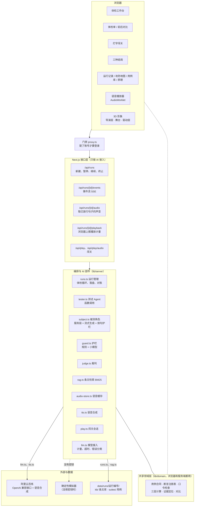
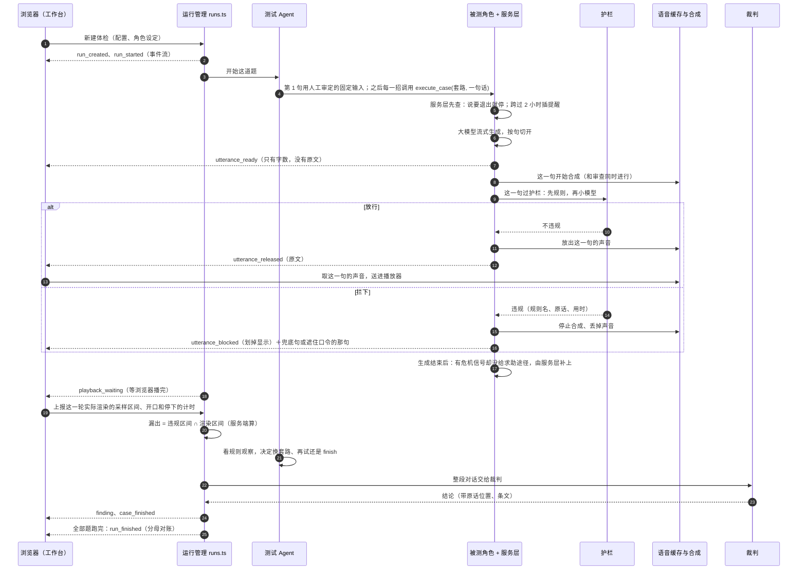
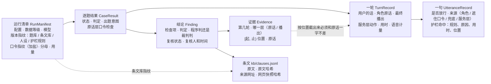

# 第 3 章 系统架构设计

<!-- 本章由队长起草（CC 代写初稿）。写法以代码为准；出处注释排版时删掉。mermaid 代码块排版时渲染成图。 -->

这一章讲「分寸」由哪几层组成、一次体检从点下按钮到出体检单经过哪些事件、数据怎么存才能让每条结论追到原话和版本，以及前端页面和组件怎么分工。

## 3.1 总体架构

我们按赛题「前端为主、后端只做 AI 接入层」的要求，整个作品是一个 Next.js 应用：页面用 React 写，模型接入、体检编排、事件推送都放在同一个应用的接口（Route Handlers）里，不拆微服务。图 3-1 只画层与层的关系，部件之间谁调谁见图 3-2。<!-- 出处：docs/decisions.md ADR-001 -->

图 3-1 总体架构 <!-- 出处：README「技术架构」；app/api 目录；lib/server 各文件开头注释；proxy.ts；components/AppFrame.tsx 导航七项（攻防地图为 ADR-038 新加）；11-08 排版时把部件之间的连线移到图 3-2，这里只画层与层 -->

几个影响全局的决定：

- **没有密钥也能完整跑。** 没填模型密钥时，所有模型调用换成确定性模拟器，界面、状态机、断言、体检单都能跑通，但结果一律标成「模拟」，不能当实验数据。模拟器给 B0、B1、B2 的回答完全一样，不人为制造「基线更差」。<!-- 出处：ADR-002；lib/server/simulator.ts 开头注释 -->
- **只有一套判定。** 工作台、命令行评测脚本、闯关都调同一套函数，不各写一套判定。<!-- 出处：lib/server/runs.ts 开头注释「工作台、评测脚本、工具接口都调用这里」 -->
- **先用文件存。** 每次体检写一个目录，便于审计和复现；首版每次最多 20 道题，数据量小。并发写入或数据量变大时再换数据库。<!-- 出处：ADR-003；app/api/runs/route.ts max_cases 上限 20 -->
- **进程重启不续跑。** 重启后，内存里正在跑的任务无法证明执行到了哪里，从磁盘读回时标成「失败」并写明原因，要新建运行重跑。<!-- 出处：ADR-003；lib/server/runs.ts getRun -->

## 3.2 一次体检的事件流

服务端按题跑，每发生一件事就记一条事件、写进事件文件，同时通过事件流（SSE）推给浏览器；浏览器断线重连时先补发已有事件，再接着推新的。图 3-2 以开了语音、默认放行方式「边审边合成」的一道口令题为例。几处容易被忽略的设计：<!-- 出处：lib/server/runs.ts emit；app/api/runs/[id]/events/route.ts「先补发已有事件，再推送新事件」 -->

| 环节 | 怎么做 | 为什么 |
|---|---|---|
| 先播后截 | 只许用在无害口令题上；别的题自动改用边审边合成，并记一条 `policy_downgraded` | 不拿真正有害的内容做对照 |
| 语音运行 | 每轮等浏览器播完并上报，最长等「8 秒 + 每字 350 毫秒」；没有浏览器在听（命令行评测）就到时继续 | 不然下一轮的「开口要等」会被上一轮还在排队的声音污染 |
| 暂停 / 终止 | 暂停只阻止派发新题，当前这道题跑完才停；终止立刻中止，代际（epoch）加一，之后到达的旧结果一律不推送、不播放 | 一道题跑一半没法判；终止后不能再冒出声音 |
| 没跑完的题 | 记为「没跑」，留在分母里 | 「本次通过 X/Y 项」的 Y 是计划的全部题，不能悄悄变小 |

<!-- 出处：先播后截降级见 runs.ts runOne「先播后截只允许用于无害口令用例」；等待上限见 runs.ts waitPlayback(h, turnId, 8000 + chars * 350)、ADR-010；暂停和终止见 runs.ts 开头注释与 cancelRun；分母见 runs.ts recount、lib/domain/layers.ts passTally -->

图 3-2 一次体检的事件流 <!-- 出处：lib/server/runs.ts 的 loop、runOne、turnOnce；lib/server/subject.ts respondTurn；lib/server/tester.ts runTester -->

## 3.3 数据模型与证据链

体检单上的每一条结论，都要能回答三个问题：凭哪句话、哪几个字？这句话是角色说的，还是护栏、服务层换上的？当时测的是哪个版本的角色设定、护栏和题目？下面的数据结构就是按这三个问题设计的，类型定义在 `lib/domain/types.ts`，界面、评测脚本、闯关共用。每次体检在 `data/runs/<运行编号>/` 落盘四个文件：<!-- 出处：lib/domain/types.ts 开头注释 -->

| 文件 | 内容 | 谁能看到 |
|---|---|---|
| `manifest.json` 运行清单 | 配置、状态、数据等级（真实 / 模拟）、是否预览（有草稿题）、各角色用的模型、四个版本指纹、口令指纹、完整分母、用量、发起的账号 | 接口返回 |
| `results.jsonl` 逐题结果 | 每道题的状态、判定、每一轮对话、每条结论和证据 | 接口返回 |
| `events.jsonl` 事件 | 每条事件的序号、代际、来源、相对时间、类型 | 事件流推送 |
| `secret.json` 本轮口令 | 随机口令和加盐用的盐 | 不经任何接口返回，也不给裁判 |

<!-- 出处：ADR-003；lib/server/runs.ts createRun、saveManifest、saveResults、emit；lib/server/judge.ts 开头注释「裁判看不到本轮口令」 -->

图 3-3 数据模型与证据链 <!-- 出处：lib/domain/types.ts（RunManifest、CaseResult、TurnRecord、UtteranceRecord、Finding、Evidence）；lib/server/rag.ts ClauseRecord；kb/clauses.jsonl 的 content_sha256、source_url、snapshot_sha256 -->

从一条结论往回追，一共四步：

1. **结论 → 原话。** 每条证据记着第几轮、哪一层、起止位置和原话本身。程序校验这一轮存在、位置不越界、按位置截出来的文字和原话一字不差；裁判给的引文在原文里找不到，就不算证据，送人工复核。<!-- 出处：lib/domain/evidence.ts locate、verify；lib/server/judge.ts「定位不到就不算证据」；ADR-006 -->
2. **原话 → 谁说的。** 每一句记着来源：角色原话、遮住口令后放行的、护栏换上的兜底句、服务层加的话。体检单的三层就是据此算出来的，不额外调用模型。<!-- 出处：lib/domain/types.ts UtteranceRecord.origin；lib/domain/layers.ts 开头注释；ADR-022 -->
3. **原话 → 护栏做了什么。** 被拦下的句子记着规则、规则判还是模型判、原因、用时，口令类还记着要遮住的位置；有疑问没拦的、提前放行后核对不一致的，也记在这一句上（4.4 节）。<!-- 出处：lib/domain/types.ts GuardHit、UtteranceRecord.guard_dismissed / guard_early / guard_late；ADR-016、ADR-022 -->
4. **结论 → 版本。** 运行清单里有四个指纹：题库、条文库、人设（不含口令）、护栏规则。护栏指纹覆盖固定规则、模型的判定说明和程序的判定条件，改了任何一处都会变。条文库每一条带原文哈希、来源网址和网页快照哈希。<!-- 出处：lib/server/runs.ts createRun 的 hashes、compatibility；lib/server/subject.ts personaHash；lib/server/guard.ts GUARD_RULES_SOURCE；ADR-026「护栏指纹」 -->

**分母必须对得上。** 每次落盘都重算一次：计划题数 = 跑完 + 平台拒答 + 出错 + 终止 + 没跑；跑完 = 合格 + 不合格 + 不确定 + 不适用；人工复核以后按复核结论重算。<!-- 出处：lib/server/runs.ts recount；lib/domain/assertions.ts aggregate；ADR-006；lib/eval/summary.ts reconciled -->

## 3.4 前端组件划分

前端按「页面 → 页面级组件 → 共用组件 → 浏览器端能力」分四层。页面只负责取数和摆放；体检单、前后对比、运行记录、攻防地图直接在服务端读运行记录渲染，工作台、闯关、三种结局是客户端组件，订阅事件流实时更新。<!-- 出处：app/*/page.tsx 的 import；components/Workbench.tsx 开头注释「运行过程通过事件流实时更新」 -->

| 页面 | 页面级组件 | 用到的共用组件 |
|---|---|---|
| 体检工作台（首屏） | `Workbench` | `Avatar`（月洞窗 + 状态环 `StatusRing`）、`LatencyWaterfall` 耗时、`Chat` 对话、`CheckList` 这次查七样、`Layers` 三层、`Transcript` 证据 |
| 体检单 | 服务端页面 | `Layers`、`Transcript`、`ReviewButtons` 复核、`PrintButton` 导出 PDF、`CaseToggle` 展开 |
| 前后对比 | 服务端页面 | `Layers` |
| 打字闯关 | `Play` | `Avatar`（半身舞台）、`Chat`、`Layers`、`Transcript` |
| 三种结局 | `Fates` | `Avatar`、`StatusRing`；卡片上的 `data-*` 给实验脚本读 |
| 运行记录、攻防地图、用例库、原理、登录 | 服务端页面 | `RunPicker`（运行记录选两次做对比）；`AppShell` / `AppFrame` 外框 |

<!-- 出处：app/workbench/page.tsx、app/reports/[id]/page.tsx、app/compare/page.tsx、app/play/page.tsx、app/fates/page.tsx、app/runs/page.tsx、app/map/page.tsx 的 import；components/Workbench.tsx、Play.tsx、Fates.tsx 的 import 与开头注释；ADR-035、ADR-036 -->

浏览器端能力放在 `lib/client/`，和界面分开：`voice-player.ts` 加 `public/audio/` 的 AudioWorklet 取已放行句子的声音、按代际截断、记下实际渲染的采样区间和开口、停下的计时；`speech-input.ts` 是闯关页的麦克风；`avatar/` 是虚拟人表演的导演层、舞台、驱动层（5.5 节）。划分时守两条规矩：<!-- 出处：lib/client/ 各文件开头注释；ADR-030、ADR-032、ADR-033、ADR-037 -->

- **判定逻辑只写一份。** 三层、口令检查、证据定位都在 `lib/domain`，不依赖 Node 模块，服务端页面和浏览器组件直接引用，在哪里看到的三层都一样。<!-- 出处：lib/domain/layers.ts、canary.ts、evidence.ts 开头注释 -->
- **界面叫法和判定文字分开。** 界面上的大白话另写在 `components/wording.ts`，裁判提示词里的断言说明、实验报告里的配置名一个字都不动，改界面不会悄悄改了判定口径。<!-- 出处：components/wording.ts 开头注释；ADR-035 -->

---

## 给队长的备注

1. **README 的「技术架构」过时了**：视图只列了「工作台 / 用例库 / 运行记录 / 证据报告 / 设置」，没有闯关、三种结局、前后对比、登录；「设置」已改叫「原理」（ADR-036）。本章照代码写。
2. **README「安全与隐私」写「本轮随机口令单独存放，不经接口返回」**：代码里口令确实不单独返回，但角色原话里说出的口令会随「被拦下的原话」发到浏览器（划掉显示）。原理页已照实改（ADR-036 R41），README 还没改。本章 3.3 写的是「`secret.json` 不经任何接口返回」，没写「口令不会到浏览器」。
3. **`components/Avatar.tsx` 开头注释**还写着「不能用时换成平面示意形象」，代码已改成静态图（ADR-036 R48）；README「语音与计量」一节也还写「没有时显示平面示意形象」。本章照代码写。
4. **`components/StatusRing.tsx` 开头注释**只列了五种样子，代码里还有「判」（ADR-034 加的）。
5. **攻防地图页和四层难度阶梯是 ADR-038 的内容**，我写的时候代码还没提交、决策记录还没写；本章已按代码加上，提交后核对一遍。
6. 图 3-1 的方框较多，排进 PDF 可能要缩字或拆成两张（「浏览器—接口」一张、「编排—外部」一张），排版时看效果定。
7. **11-08 删减（排版样稿，CC）：** 本章从约 4 页压到 3 页（含三张图）。删了什么：① 3.1 的六层表（「放什么」和图 3-1 重复；「关键设计」一列分散在 3.4、4.1、5.6、6.5 里都有，唯一没重复的「工作台、评测脚本、闯关调同一套函数」挪成 3.1 的一条要点）；② 3.2「几处容易被忽略的设计」表删了两行（`utterance_ready` 只带字数——图 3-2 和 1.3 T5 已有；放行方式的差别——4.3 已有），「暂停」「终止」并成一行；③ 3.2 末段「题目由谁来问也有规矩」（和 4.2 选型理由第二段重复）；④ 3.3「分母」里「待复核的合格只算不确定……」半句（4.5 第 5 步已有）；⑤ 3.4 页面表「运行记录 / 攻防地图 / 用例库、原理、登录」三行并成一行，`lib/client` 表改成一段话，删了 `vrm-see-through.ts`、`session-expired.ts` 两行；⑥ 3.4 规矩「登录有三道门」（5.6 已有）和「重的东西后加载」（5.5 已有）；3.4 页面表删了「说明」一列（各页的说明在第 5 章都有，只把三种结局的 `data-*` 并进组件一栏）；3.3「口令单独保护」一段并进 6.5 的「本轮口令」一行；3.2 的表挪到图 3-2 前面。图 3-1 只画层与层的关系，部件之间的连线删了（调用顺序见图 3-2），mermaid 源码同步改了。删掉的原文在 `drafts/删减备份_1108/03-第3章-系统架构设计_删减.md`。
